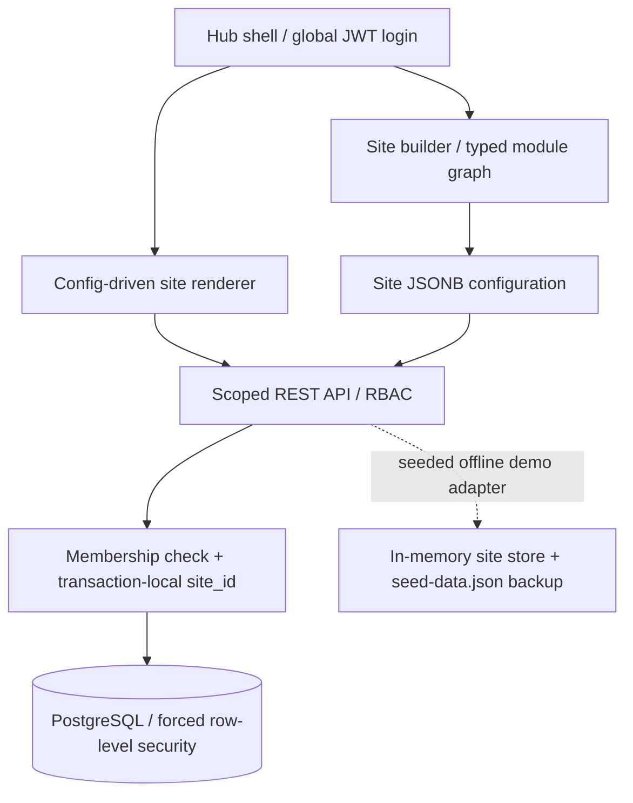

# OpsHub One Architecture

## Runtime



The browser keeps one JWT for the global account. Site membership and the site role are resolved on each tenant request; the client never supplies an authoritative role. The site switcher changes site configuration, theme, modules, navigation, and tenant-scoped data. It does not change the authenticated identity.

Central Stores replenishment requests are an intentional inter-site workflow: Central Stores validates the source product, resolves the matching Distribution product by normalized SKU or exact product name, then writes the request into Distribution's queue. Distribution owns the approval, stock decrement, and dispatch assignment. The Central Stores request view includes only Distribution requests whose `sourceSiteId` points back to that store, so the originating team can follow status without gaining access to Distribution's other records.

## Site configuration

Each site is represented by:

```ts
{
  siteId: string,
  slug: string,
  theme: { accent: string, canvas: string, ink: string, label: string },
  modules: ModuleKey[],
  pages: SitePage[],
  roles: ('Public' | 'Member' | 'Manager' | 'Admin')[],
  config: { nodes: FlowNode[], edges: FlowEdge[] }
}
```

Site configuration is stored as JSONB in `sites.config`; renderer navigation and screens use the published module/page data. The builder validates every edge by matching the source output type with the target input type, and the API repeats this validation against its server-owned port registry before persisting. Approval requires a connected Request node. Publishing snapshots the configuration and increments the site release. Rollback restores a snapshot and creates a new release entry instead of erasing history. Inventory and request forms render from typed field-schema metadata; several operational screens still use dedicated UI components rather than a universal arbitrary-site renderer.

## Data model

| Table | Scope | Purpose |
| --- | --- | --- |
| `users` | Hub | Global credentials and global role; passwords are bcrypt hashes, with an optional unique phone for MiniMoth OTP login. |
| `sites` | Tenant | Identity, theme, modules, pages, JSONB configuration, release counter. |
| `site_memberships` | Tenant | User-to-site binding and site role. |
| `site_records` | Tenant | Typed operational records (`inventory`, `requests`, `approvals`, `assignments`, `consumption`, `returns`, `repairs`), each with `site_id`. |
| `site_releases` | Tenant | Immutable version snapshots and deploy history. |

`site_id` is enforced twice: route/repository methods require a membership and include the requested tenant key; PostgreSQL `FORCE ROW LEVEL SECURITY` additionally checks `opshub.site_id` set inside the request transaction. A request using another site's record id cannot resolve or mutate that record.

## Workflow transaction

The `POST /api/:siteId/approvals` path locks the request and stock rows, verifies the pending request and available quantity, then records the approval, updates inventory, marks the request assigned, and creates the assignment in one transaction. Central Stores replenishment requests are stored in Distribution, so Distribution's approval decrements Distribution inventory. Consumption and returns lock their assignment and enforce the remaining issued quantity; good/unused returns also restock the item in the same transaction. Inventory records can be edited; deletion is refused while workflow history references the item. A failure rolls back the full PostgreSQL operation. The memory demo adapter follows the same checks but does not claim database durability or cross-process transaction guarantees.

MiniMoth is an optional phone-verification provider, not the OpsHub identity/authorization authority. The API key is read only from `MINIMOTH_API_KEY` on the server. OTP verification must match a phone already enrolled on an OpsHub user, after which OpsHub issues its own JWT. The MiniMoth refresh token is not stored because OpsHub only consumes the provider's OTP verification result. The provider contract is covered with a mock; live delivery and provider-side rate behavior remain unverified.

## API outline

All routes except health and login require `Authorization: Bearer <JWT>`.

| Method | Route | Access | Behavior |
| --- | --- | --- | --- |
| `POST` | `/api/auth/login` | Public | Verify bcrypt credential and issue JWT. |
| `GET` | `/api/auth/methods` | Public | Report whether password and optional MiniMoth phone OTP are available. |
| `POST` | `/api/auth/otp/send`, `/api/auth/otp/verify` | Public | Send OTP to an enrolled E.164 phone, verify through MiniMoth, then issue an OpsHub JWT. |
| `GET` | `/api/auth/methods` | Public | Report whether optional MiniMoth OTP is configured. |
| `POST` | `/api/auth/otp/send`, `/api/auth/otp/verify` | Public | Send and verify OTP for a phone enrolled to an OpsHub user. |
| `GET` | `/api/session`, `/api/sites` | Signed in | List only sites with membership. |
| `POST` | `/api/sites` | Global Admin | Provision isolated site and Admin membership. |
| `GET/POST` | `/api/users` | Global Admin | Manage global users. |
| `GET` | `/api/:siteId/:resource` | Site member | Read a site-scoped collection. |
| `POST/PATCH/DELETE` | `/api/:siteId/inventory[/:itemId]` | Site Manager+ | Create/update items; refuse deletion when workflow history references an item. |
| `POST` | `/api/:siteId/requests` | Site Member+ | Create a validated request. |
| `POST` | `/api/:siteId/approvals` | Site Manager+ | Approve/reject; approval also issues stock atomically. |
| `POST` | `/api/:siteId/components` | Site Admin | Persist Zod-validated nodes, registry-matched ports, typed edges, and module list; require Request input for Approval. |
| `GET/POST` | `/api/:siteId/releases` | Member / Admin | Read deploy history or publish a snapshot. |
| `POST` | `/api/:siteId/releases/:releaseId/rollback` | Site Admin | Restore a snapshot as a new release. |
| `GET` | `/api/:siteId/reports/export.xlsx` | Site Manager+ | Export scoped inventory, requests, and assignments. |
| `POST` | `/api/:siteId/reports/import` | Site Manager+ | Upsert inventory rows from an Excel workbook. |

`MINIMOTH_API_KEY` is read only by the server. MiniMoth verifies phone ownership; OpsHub maps the enrolled phone to a local user and issues its own JWT. The key is not sent to the browser, and MiniMoth refresh tokens are not retained because OpsHub uses the provider's OTP-only verification pattern.

Role hierarchy is `Public < Member < Manager < Admin`. The API checks site membership before role rank. Global Admin is not a substitute for a tenant membership.
